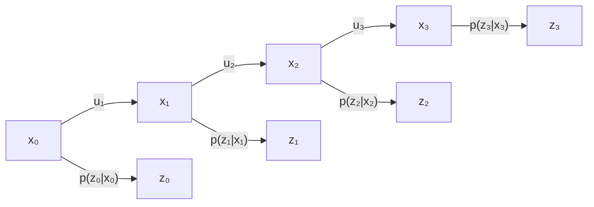

# 第 02 章｜递归状态估计与贝叶斯滤波

第 01 章确立了概率机器人的表示论——置信就是分布 $\mathrm{bel}(x_t) = p(x_t \mid z_{1:t}, u_{1:t})$，并给出了"预测摊开、更新收窄"的口诀。本章把这个口号变成**可推导、可执行**的算法：先备齐全书要用的概率工具（02.1），把"机器人-环境交互"翻译成两个随机变量流和两个概率法则（02.2），然后给出贝叶斯滤波算法与**从公理出发的完整推导**（02.3–02.4），用一个门状态实例手算四轮"感知-动作"循环直到能看清收敛、饱和与"矛盾测量"的行为（02.3），最后划清这条算法链的适用边界——马尔可夫假设何时被违反（02.5）与精确计算何时不可得（02.6）。本章是第 03 章（高斯实现）、第 04 章（非参数实现）乃至全书所有滤波/定位/SLAM/规划章节的共同源头；与 [slam 教程第 03 章](../slam/03_概率状态估计基础.md)的压缩版推导互为参照。

> 原书锚点：第 2 章，书 10–27 页（PDF 28–45 页），习题在书 27–28 页（PDF 45–46 页）。
> 本章推导对应原书 2.4.3 节（式 2.35–2.41），教程将每一步的代数展开补全。

## 02.1 概率工具箱：全书要用的 12 件工具（原书 2.2 节）

**① 问题场景**

后续每一章的推导都建立在一小套概率事实之上。它们散落在原书 2.2 节的式 (2.1)–(2.28) 中，若只"认得"而不"会推"，后面 EKF 的配平方、粒子滤波的权重递推就会处处卡壳。本节一次备齐，并在其中完成两个小证明（它们正是原书习题 5、6 的答案）。

**② 工具清单**

| # | 工具 | 公式 | 原书式号 |
|---|------|------|----------|
| 1 | 离散概率归一性 | $\sum_x p(x) = 1$，$p(x) \ge 0$ | (2.1)(2.2) |
| 2 | 一维高斯密度 | $p(x) = (2\pi\sigma^2)^{-1/2}\exp\{-\tfrac12 (x-\mu)^2/\sigma^2\}$ | (2.3) |
| 3 | 多维高斯密度 | $p(x) = \det(2\pi\Sigma)^{-1/2}\exp\{-\tfrac12 (x-\mu)^T\Sigma^{-1}(x-\mu)\}$ | (2.4) |
| 4 | 密度归一性 | $\int p(x)\,dx = 1$（注意：密度值可以 $>1$） | (2.5) |
| 5 | 联合 / 独立 | $p(x,y)$；独立时 $p(x,y) = p(x)p(y)$ | (2.6)(2.7) |
| 6 | 条件概率定义 | $p(x \mid y) = p(x,y)/p(y)$（要求 $p(y)>0$） | (2.8)(2.9) |
| 7 | 全概率定理 | $p(x) = \sum_y p(x \mid y)p(y)$ 或 $\int p(x \mid y)p(y)\,dy$ | (2.11)(2.12) |
| 8 | 贝叶斯准则 | $p(x \mid y) = \eta\, p(y \mid x)p(x)$ | (2.13)–(2.15) |
| 9 | 条件化贝叶斯 | $p(x \mid y, z) = \eta\, p(y \mid x, z)\, p(x \mid z)$ | (2.16) |
| 10 | 条件独立 | $p(x, y \mid z) = p(x \mid z)p(y \mid z)$ | (2.17) |
| 11 | 期望与协方差 | $E[X] = \int x\,p(x)dx$；$E[aX+b] = aE[X]+b$；$\mathrm{Cov}[X] = E[X^2] - E[X]^2$ | (2.22)–(2.25) |
| 12 | 熵 | $H_p(x) = -\int p(x)\log_2 p(x)\,dx$ | (2.26)–(2.28) |

三维高斯式 (2.4) 是式 (2.3) 的严格推广：$x$ 取标量、$\Sigma = \sigma^2$ 时两者逐字相同——建议读者当场展开 $\det(2\pi\Sigma)^{-1/2} = (2\pi\sigma^2)^{-1/2}$ 与 $(x-\mu)^T\Sigma^{-1}(x-\mu) = (x-\mu)^2/\sigma^2$ 自行验证。第 03 章将对高斯做更深的代数（四个引理），此处只需认识它。

**③ 关键推导一：贝叶斯准则（工具 8）**

贝叶斯准则不是公理，而是条件概率定义的两步代数。由定义（工具 6）：

$$p(x \mid y) = \frac{p(x,y)}{p(y)}, \qquad p(y \mid x) = \frac{p(x,y)}{p(x)}. \tag{2.1}$$

第二式两边同乘 $p(x)$ 得 $p(x,y) = p(y \mid x)\,p(x)$，代回第一式：

$$p(x \mid y) = \frac{p(y \mid x)\,p(x)}{p(y)}. \tag{2.2}$$

分母可用全概率定理（工具 7）展开：$p(y) = \sum_{x'} p(y \mid x')p(x')$——它对**所有** $x$ 取同一个值，与我们在求的 $x$ 无关，因此整个机器人学把它记作归一化常数：

$$p(x \mid y) = \eta\, p(y \mid x)\,p(x), \qquad \eta = p(y)^{-1}. \tag{2.3}$$

命名约定贯穿全书：$p(x)$ 是**先验**（prior，综合数据 $y$ 之前的知识），$p(y \mid x)$ 是**生成模型**（generative model，"状态为 $x$ 时如何产生数据 $y$"——传感器模型与运动模型都属于这一类），$p(x \mid y)$ 是**后验**（posterior）。贝叶斯准则的全部威力在于：我们能写下的往往是"由因到果"的生成模型（状态 → 测量），而想知道的是"由果推因"的后验——准则把方向逆转的代价降到一次乘法。注意同一记号 $\eta$ 在不同公式中取不同值（原书特别声明），它只表示"最终结果必须归一化为 1"。

**④ 关键推导二：条件独立的两个等价定义（工具 10，原书习题 5）**

条件独立的定义是 $p(x, y \mid z) = p(x \mid z)\,p(y \mid z)$（式 2.17）。原书断言它等价于 $p(x \mid z) = p(x \mid z, y)$（式 2.18）——即"知道 $z$ 后，$y$ 对 $x$ 不再提供信息"。证明双向：

- **正向**：条件概率定义给出 $p(x \mid z, y) = p(x, y \mid z)/p(y \mid z)$。代入定义式右边 $p(x \mid z)p(y \mid z)/p(y \mid z) = p(x \mid z)$；
- **反向**：若 $p(x \mid z, y) = p(x \mid z)$，则 $p(x, y \mid z) = p(x \mid z, y)\,p(y \mid z) = p(x \mid z)\,p(y \mid z)$。$\blacksquare$

两个必须分清的边界（原书式 2.20、2.21）：条件独立**推不出**绝对独立，绝对独立也**推不出**条件独立。经典例子：掷两次同一枚硬币，结果绝对独立；但若 $z$ 是"这枚硬币是否被做了手脚"，则在 $z$ 条件下两次结果变得相关。机器人学里，条件独立比绝对独立重要得多——02.2 的两个生成法则全是条件独立。

**⑤ 期望、协方差与熵（工具 11、12）**

协方差的第二种形式（原书习题 6）：由期望的线性性展开

$$\mathrm{Cov}[X] = E\big[(X - E[X])^2\big] = E[X^2] - 2E[X]\,E[X] + E[X]^2 = E[X^2] - E[X]^2. \tag{2.4}$$

意义：偏离均值的二阶矩可以从**原始矩**算出，不必先知道均值；它恒非负，取零当且仅当 $X$ 几乎处处为常数。

熵 $H_p(x) = E[-\log_2 p(x)]$ 的编码解释：观测到概率为 $p(x)$ 的事件，最优编码需要 $-\log_2 p(x)$ 比特；熵即平均描述长度。分布越"尖"熵越小（均匀分布取最大值）。机器人学关心熵的理由：**置信的熵 = 机器人的无知程度**，而"执行一个动作能减少多少熵"就是"这个动作值多少信息"——第 17 章的探测（exploration）将把这句话写成算法，02.3 的门实例会逐轮计算熵让你看到信息入账。

**⑤' 边界提醒**

连续随机变量的密度值可以大于 1（工具 4）——初学者最常见的口误是"概率密度不能超过 1"；受限的是积分。此外原书默认所有连续分布都拥有密度（可测性），本书沿用这一隐含假设，遇到例外（如点质量、混合分布）会显式声明。

## 02.2 机器人-环境交互的形式化模型（原书 2.3 节）

**① 问题场景**

要把"机器人在世界中感知并行动"写成可推导的数学，需要三样东西：一个**状态**变量刻画"世界中所有影响未来的因素"，两条**数据流**刻画机器人能收到什么，以及连接它们的**概率法则**。法则若以"全部历史"为条件，问题根本无法计算；整个概率机器人的可计算性押在一组精心选择的条件独立上。

**② 状态：完整与不完整**

状态 $x_t$ 的定义性要求是**完整性**（completeness）：$x_t$ 是对未来的一切预测所需要的信息之**充分总结**——给定 $x_t$，未来与 $x_t$ 之前的任何状态、测量、控制都条件独立。满足此性质的过程即马尔可夫链（Markov chain）。注意完整性**不要求**未来是 $x_t$ 的确定函数——允许随机，只要求随机性不再被更早的变量影响。

典型状态变量清单（原书列举）：机器人位姿（平面 3 自由度 / 空间 6 自由度）、运动学状态（关节角配置）、动力学状态（速度，本书用处很少）、环境中静态物体的位置与特征（路标 landmark）、移动物体与人的位置速度、以及传感器故障标志、电量等级等"运营变量"。状态空间可连续（位姿）、离散（门的开闭、传感器好坏）或混合（两者并存）。

诚实的注脚（原书明言）：**任何真实系统的状态都不完整**——完整状态还得包括内存内容、周围人的想法等不可获得之物。工程实践永远是在挑一个小的状态子集 $x_t$，赌"遗漏的变量影响接近随机"（02.5 将回到这个赌注）。

**③ 两条数据流：测量与控制**

$$z_{t_1:t_2} = \{z_{t_1}, z_{t_1+1}, \dots, z_{t_2}\} \quad(\text{测量序列}), \qquad u_{t_1:t_2} = \{u_{t_1}, u_{t_1+1}, \dots, u_{t_2}\} \quad(\text{控制序列}) \tag{2.5}$$

两条流的**信息角色不对称**，这是全章最重要的一条定性结论：测量提供环境**当前状态**的信息（增信息）；控制携带状态**如何变化**的信息，且因执行噪声与环境随机性，运动总体上**破坏**信息。两个容易忽视的约定：

1. **里程计算控制数据**，不算测量——它测的是轮子转了多久，是"指令执行效果"的记录，属于 $u$ 流（对初学者这是最反直觉的一条；第 05 章的里程计运动模型将兑现这个分类）；
2. **"什么都不做"也是一个控制**——时间流逝本身改变世界，因此每个时间步都假定恰有一个控制项，保证记号整齐。

时序约定：$u_t$ 与时间区间 $(t-1, t]$ 内的状态变化相关，$z_t$ 是区间末端的感知。于是一次迭代天然排成"**先动后看**"：$u_t$ 作用 → 状态到达 $x_t$ → $z_t$ 到达。这就是 02.3 算法里预测步在更新步之前的时序来源。

**④ 两个概率生成法则：全部可计算性所系**

若直接写状态演化，条件集将是全部历史：$p(x_t \mid x_{0:t-1}, z_{1:t-1}, u_{1:t})$。**完整状态假设**把它砍到只剩一项：

$$p(x_t \mid x_{0:t-1}, z_{1:t-1}, u_{1:t}) = p(x_t \mid x_{t-1}, u_t) \qquad \text{（状态转移概率）} \tag{2.6}$$

$$p(z_t \mid x_{0:t}, z_{1:t-1}, u_{1:t}) = p(z_t \mid x_t) \qquad \text{（测量概率）} \tag{2.7}$$

直观论证（原书 2.3.3）：若 $x_{t-1}$ 完整，它就是截至 $t-1$ 时刻全部控制与测量的**充分统计量**——再知道更早的测量/控制不会改变你对 $x_t$ 的预测；同理 $x_t$ 完整时，$z_t$ 的（带噪声的）取值与一切历史无关。这两条都是**条件独立**（02.1 工具 10），它们是把无穷维历史问题变成一维递归问题的全部代价。与时间无关时简记 $p(x' \mid u, x)$ 与 $p(z \mid x)$。两个分布一起构成动态贝叶斯网络（DBN，等价术语：隐马尔可夫模型 HMM）：



每个箭头是一个概率表/密度：横向箭头是转移概率，纵向箭头是测量概率。观测 $z$ 是唯一能"看见"的节点（hence "隐"马尔可夫），这正是 02.7 习题 3 的模型。

**⑤ 置信分布：预测与修正**

$$\mathrm{bel}(x_t) = p(x_t \mid z_{1:t}, u_{1:t}) \qquad \text{（后验）} \tag{2.8}$$
$$\overline{\mathrm{bel}}(x_t) = p(x_t \mid z_{1:t-1}, u_{1:t}) \qquad \text{（预测，刚执行完 } u_t \text{、尚未见到 } z_t\text{）} \tag{2.9}$$

由 $\overline{\mathrm{bel}}$ 计算 $\mathrm{bel}$ 的步骤称为**修正**（correction）或**测量更新**（measurement update）。[slam 教程 03 章](../slam/03_概率状态估计基础.md)将 $\overline{\mathrm{bel}}$ 记作 $\mathrm{bel}^-$，同一对象。

## 02.3 贝叶斯滤波：算法、实例与四轮手算

**① 问题场景**

$\mathrm{bel}(x_t)$ 以全部历史为条件—— naive 的做法是把历史全存下来每次重算，内存与延迟随 $t$ 增长。想要：只用上一时刻的置信 $\mathrm{bel}(x_{t-1})$ 加上最新数据 $(u_t, z_t)$ 就能递归出 $\mathrm{bel}(x_t)$。

**② 解决方法：程序 2.1**

```text
Algorithm Bayes_filter( bel(x_{t-1}), u_t, z_t ):
    for all x_t do
        bel̄(x_t) = ∫ p(x_t | u_t, x_{t-1}) bel(x_{t-1}) dx_{t-1}   # 预测（控制更新）
        bel(x_t) = η p(z_t | x_t) bel̄(x_t)                          # 测量更新（修正）
    endfor
    return bel(x_t)
```

预测步是全概率定理（02.1 工具 7）的直接照面：把上一时刻置信与转移概率卷积起来；测量步是贝叶斯准则（02.1 工具 9）的照面：似然对先验重加权。递归正确性在 02.4 证明；初始置信 $\mathrm{bel}(x_0)$ 是边界条件，三种初始化对应三种任务：确定初值用点质量（δ 分布）、完全无知用均匀分布、部分信息用非均匀分布——这个选择在第 07 章将成为"全局定位 vs 位姿跟踪"的分类依据。

**③ 选型理由**

递归的合法性正来自 02.2 的两条条件独立：完整状态使 $\mathrm{bel}(x_{t-1})$ 成为历史的充分统计量，于是固定内存 + 固定延迟成为可能。替代方案（存全部历史做批量估计）在数学上等价、工程上不可行（内存与延迟随时间线性增长）。代价是：马尔可夫假设被违反时，递归滤波**无路可退**——历史信息已被压缩进上一时刻的分布，错过的证据无法回头重算（批量法可以，这正是第 11 章 GraphSLAM 作为"全后验"方法的动机之一）。

**④ 实例设定：门状态估计（原书 2.4.2）**

状态 $x \in \{\text{开}, \text{关}\}$，只有机器人能改变门的状态。三个模型：

- **初始置信**（完全无知）：$\mathrm{bel}(x_0) = (0.5,\ 0.5)$；
- **测量模型**（相机看门，两处都不可靠）：

| | $z$=见开 | $z$=见关 |
|---|---|---|
| $x$=开 | 0.6 | 0.4 |
| $x$=关 | 0.2 | 0.8 |

- **运动模型**（推门 push：关门有 0.8 概率被推开；do-nothing：恒等变换）：

| | →开 | →关 |
|---|---|---|
| push，$x_{t-1}$=开 | 1 | 0 |
| push，$x_{t-1}$=关 | 0.8 | 0.2 |

**⑤ 四轮手算**（前三轮按原书，第 4 轮为本教程增补的"矛盾测量"实验）

**t=1：$u_1$=do-nothing，$z_1$=见开。** 预测（恒等变换，积分退化为直接相加两个转移×置信）：
$$\overline{\mathrm{bel}}(x_1{=}\text{开}) = 1 \times 0.5 + 0 \times 0.5 = 0.5, \qquad \overline{\mathrm{bel}}(x_1{=}\text{关}) = 0.5.$$
（预测后分布未变——恒等转移下这是应该的。）更新（未归一化 = 似然 × 预测）：
$$\text{开}： 0.6 \times 0.5 = 0.3, \qquad \text{关}： 0.2 \times 0.5 = 0.1; \qquad \eta = (0.3+0.1)^{-1} = 2.5,$$
$$\mathrm{bel}(x_1) = (0.75,\ 0.25).$$

**t=2：$u_2$=push，$z_2$=见开。** 预测：
$$\overline{\mathrm{bel}}(x_2{=}\text{开}) = 1 \times 0.75 + 0.8 \times 0.25 = 0.95, \qquad \overline{\mathrm{bel}}(x_2{=}\text{关}) = 0 \times 0.75 + 0.2 \times 0.25 = 0.05.$$
更新：未归一化 $(0.6 \times 0.95,\ 0.2 \times 0.05) = (0.57,\ 0.01)$，$\eta = 0.58^{-1}$：
$$\mathrm{bel}(x_2) = (0.983,\ 0.017).$$

**t=3：$u_3$=do-nothing，$z_3$=见开。** 预测不变 $(0.983,\ 0.017)$；更新未归一化 $(0.6 \times 0.983,\ 0.2 \times 0.017) = (0.590,\ 0.0034)$，$\eta = 0.593^{-1}$：
$$\mathrm{bel}(x_3) \approx (0.994,\ 0.006).$$

**t=4（增补实验）：$u_4$=do-nothing，$z_4$=见关——与三次累积证据矛盾的测量。** 预测不变 $(0.994,\ 0.006)$；更新未归一化 $(0.4 \times 0.994,\ 0.8 \times 0.006) = (0.3977,\ 0.0046)$，$\eta = 0.4023^{-1}$：
$$\mathrm{bel}(x_4) \approx (0.988,\ 0.012).$$

汇总与熵跟踪（熵按 $H = -\sum p\log_2 p$）：

| $t$ | 控制 | 测量 | 预测 $\overline{\mathrm{bel}}$ | 后验 $\mathrm{bel}$（开, 关） | 后验熵（bit） |
|-----|------|------|--------------------------------|-------------------------------|----------------|
| 0 | — | — | — | (0.5, 0.5) | 1.000 |
| 1 | nothing | 开 | (0.5, 0.5) | (0.75, 0.25) | 0.811 |
| 2 | push | 开 | (0.95, 0.05) | (0.983, 0.017) | 0.126 |
| 3 | nothing | 开 | (0.983, 0.017) | (0.994, 0.006) | 0.052 |
| 4 | nothing | **关** | (0.994, 0.006) | (0.988, 0.012) | **0.091 ↑** |

三个值得停下来想的现象：

1. **0.983 还不够好**（原书原话的警示）：若"门开"判错会导致撞门，0.017 的错误概率仍须进入决策——原书类比"一架不撞毁概率为 0.983 的自动驾驶飞机"。概率估计的价值不止于给出最可能值，更在于把**剩余风险显式地交还给决策层**（第 14 章起）。
2. **矛盾测量只砸出一个浅坑**：第 4 轮与此前三次累积证据相悖，置信仅从 0.994 退到 0.988。贝叶斯更新天然"按证据强度说话"——单次弱证据撬不动强后验。这既是**鲁棒性**（偶发传感器毛刺不致翻转），也埋着**过度自信**的隐患：若门真的被人关上了（未建模的世界变化），滤波器会长时间视而不见——02.5 与第 08 章的动态环境定位正是为此而来。
3. **熵的两次"反常"**：第 2 轮 push 之后预测熵从 0.811 **降**到 0.286——"运动必增不确定"是经验法则而非定理：push 的转移矩阵把分布推向"开"这一侧，非对称的动作可以让结果更可预测；原书"运动丢失信息"针对的是加性噪声的典型情形（第 05 章）。第 4 轮测量后熵从 0.052 **升**到 0.091——**与预期不符的测量会增加不确定性**："测量必减熵"同样只是典型情形。熵作为"信息入账"的账本，收支两条方向都要认识。

## 02.4 贝叶斯滤波的完整数学推导（原书 2.4.3 展开）

**推导目标与结构**：证明递归正确——归纳假设 $\mathrm{bel}(x_{t-1}) = p(x_{t-1} \mid z_{1:t-1}, u_{1:t-1})$ 正确，推出 $\mathrm{bel}(x_t)$ 正确；基例 $\mathrm{bel}(x_0)$ 由初始化给出。推导需要两条假设：状态 $x_t$ 完整（02.2），控制随机可选（控制序列作为数据给定，控制器不通过"未入置信的侧信道"注入关于状态的信息）。

**第一步：用条件化贝叶斯准则展开目标后验。** 以 $(y, z) = (z_t,\ \{z_{1:t-1}, u_{1:t}\})$ 套用工具 9（原书式 2.16），再代归一化：

$$p(x_t \mid z_{1:t}, u_{1:t}) = \frac{p(z_t \mid x_t, z_{1:t-1}, u_{1:t})\; p(x_t \mid z_{1:t-1}, u_{1:t})}{p(z_t \mid z_{1:t-1}, u_{1:t})} = \eta\; p(z_t \mid x_t, z_{1:t-1}, u_{1:t})\; p(x_t \mid z_{1:t-1}, u_{1:t}). \tag{2.10}$$

**第二步：测量条件独立 → 测量更新。** 由 $x_t$ 完整（02.2 式 2.7）：知道 $x_t$ 后，$z_t$ 与全部历史无关：

$$p(z_t \mid x_t, z_{1:t-1}, u_{1:t}) = p(z_t \mid x_t), \tag{2.11}$$

代回 (2.10)：

$$\mathrm{bel}(x_t) = \eta\; p(z_t \mid x_t)\; p(x_t \mid z_{1:t-1}, u_{1:t}) = \eta\; p(z_t \mid x_t)\; \overline{\mathrm{bel}}(x_t). \tag{2.12}$$

这正是程序 2.1 第 4 行——**测量更新**得证。注意 $\eta$ 分母是 $p(z_t \mid z_{1:t-1}, u_{1:t}) = \int p(z_t \mid x')\overline{\mathrm{bel}}(x')dx'$（全概率），与 $x_t$ 无关。

**第三步：全概率展开预测项。** 对 (2.12) 中的 $\overline{\mathrm{bel}}(x_t) = p(x_t \mid z_{1:t-1}, u_{1:t})$，用乘法公式拆出 $x_{t-1}$、再对它边缘化（工具 6 + 7，原书式 2.39）：

$$\overline{\mathrm{bel}}(x_t) = \int p(x_t \mid x_{t-1}, z_{1:t-1}, u_{1:t})\; p(x_{t-1} \mid z_{1:t-1}, u_{1:t})\; dx_{t-1}. \tag{2.13}$$

**第四步：转移条件独立 → 预测。** 由 $x_{t-1}$ 完整（02.2 式 2.6）：知道 $x_{t-1}$ 后，更早的测量与控制不传递关于 $x_t$ 的任何信息：

$$p(x_t \mid x_{t-1}, z_{1:t-1}, u_{1:t}) = p(x_t \mid x_{t-1}, u_t). \tag{2.14}$$

两处细节是原书从略、也是初学最易含糊的：

- **为什么保留 $u_t$**：$u_t$ 作用在区间 $(t-1, t]$ 上，晚于 $x_{t-1}$，不在"完整状态 $x_{t-1}$ 的总结范围"内，条件独立消不掉它。反证 sanity check：$p(x_t \mid x_{t-1}, u_t) \ne p(x_t \mid x_{t-1})$——不知道执行了什么动作，当然无法预测状态怎么变。
- **为什么第二因子可以丢掉 $u_t$**：$p(x_{t-1} \mid z_{1:t-1}, u_{1:t})$ 中，$u_t$ 在因果上晚于 $x_{t-1}$，不可能改变已发生的状态；条件在一个不提供信息的变量上不改变分布（工具 10 的等价定义），故 $p(x_{t-1} \mid z_{1:t-1}, u_{1:t}) = p(x_{t-1} \mid z_{1:t-1}, u_{1:t-1}) = \mathrm{bel}(x_{t-1})$（归纳假设）。

代回 (2.13)：

$$\overline{\mathrm{bel}}(x_t) = \int p(x_t \mid u_t, x_{t-1})\; \mathrm{bel}(x_{t-1})\; dx_{t-1}. \tag{2.15}$$

这正是程序 2.1 第 3 行——**预测步**得证。

**第五步：归纳收口。** (2.12) 与 (2.15) 连接即得贝叶斯滤波；基例 $\mathrm{bel}(x_0) = p(x_0)$ 由初始置信给出（点质量/均匀/非均匀三种）。有限状态空间下积分化为求和——02.3 的手算就是 (2.15) 的两行求和。$\blacksquare$

推导还揭示算法的三个**输入依赖**：任何具体实现都必须给出 $p(x_0)$、$p(x_t \mid u_t, x_{t-1})$、$p(z_t \mid x_t)$——分别是第 05 章（运动模型）、第 06 章（测量模型）与初始置信的内容；而 $\mathrm{bel}$ 的表示方式正是第 03、04 章的分野。

## 02.5 马尔可夫假设的边界：四类破坏者（原书 2.4.4）

马尔可夫（完整状态）假设是 02.4 每一行推导的承重墙，但 02.2 已承认真实状态永远不完整。原书列出的四类破坏因素，配以机器人定位的实例与典型后果：

| 破坏者 | 定位中的实例 | 后果 |
|--------|--------------|------|
| 未建模的动态环境因素 | 走廊里的行人在移动，持续影响激光读数 | 测量间经由隐藏变量**相关**，后验系统性偏差 |
| 模型不精确 | $p(z_t \mid x_t)$、$p(x_t \mid u_t, x_{t-1})$ 本身有误差（地图不准、噪声参数错） | 滤波器对模型误差"信以为真"，置信过度收缩（过度自信） |
| 置信的近似表示 | 栅格/高斯/有限粒子集的表示误差（第 03、04 章的主角） | 近似误差逐轮累积，可能淹没真实信息 |
| 软件状态变量 | "目标位置"变量影响整个控制序列，却不在 $x_t$ 中 | 控制数据与隐藏状态相关，破坏"控制随机可选" |

三条工程结论：① **不完整状态常常是更好的选择**——把可获得的变量全部塞进状态会换来计算爆炸，正确的赌注是挑选子集，使未建模变量的影响**接近随机**（这就是"约定优于完整"的设计准则）；② 贝叶斯滤波对违反有**惊人的鲁棒性**（微小违反 → 缓慢偏差，而非发散——但 02.3 第 4 轮的"浅坑"现象提示：强后验对模型错误的纠正也很慢）；③ 检测违反本身是困难的（01.1 的自指难题），主动的对策见第 08 章（动态环境定位、随机粒子注入）与 02.7 习题 2(g) 的"季节"讨论——**把可观测的破坏变量增广进状态，是恢复马尔可夫性质的标准手术**。

## 02.6 精确不可得：近似的三个评价准则（原书 2.5）

程序 2.1 只在两种情形下可以**精确**执行：有限状态空间（积分为有限求和）或线性高斯模型（积分有闭式解——第 03 章证明）。一般机器人问题中置信必是近似的。原书给出选择近似的三准则：

1. **计算效率**：线性高斯近似在状态维数的多项式时间内可解；粒子方法具有**任意时间**（any-time）特性——随时可停，停得越早精度越低；
2. **近似精度**：线性高斯只能表达单峰；直方图可表达多峰但受网格分辨率限制；粒子可表达很宽的分布族，代价是样本数；
3. **易于实现**：粒子方法对复杂非线性系统往往最简单——这是它流行的重要原因。

这三条准则是第 03 章（高斯路线）与第 04 章（非参数路线）各自的"立项申请书"，也将在第 07、08 章（定位）转化为具体的工程选型。

## 02.7 小结、术语表与书后习题全解

**要点回顾**：

1. 贝叶斯准则是条件概率定义的两步代数（式 2.2），其分母与待求变量无关故记作 $\eta$；条件独立的两个等价定义互推只要一行（02.1）；
2. 机器人-环境交互 = 状态 $x_t$ + 两条数据流（$z_t$ 增信息、$u_t$ 载变化）+ 两条条件独立生成法则（式 2.6、2.7），即一个 DBN/HMM；
3. 贝叶斯滤波 = 预测（全概率）+ 测量更新（贝叶斯准则），递归正确性由"完整状态 ⇒ 充分统计量"保证，归纳证明五步（02.4）；
4. 门实例四轮手算显示：置信收敛、0.983 的剩余风险须交还决策、矛盾测量只砸浅坑、动作非对称转移可减熵、意外测量可增熵（02.3）；
5. 马尔可夫假设有四类破坏者；设计准则是"挑子集、赌未建模影响接近随机"；恢复手段是把可观测变量增广进状态（02.5）；
6. 精确滤波只在有限状态/线性高斯可行；近似按效率、精度、易实现性三准则评价（02.6）。

**术语表（本章新增）**：状态 / 完整状态 / 不完整状态（state / complete / incomplete state）、马尔可夫链（Markov chain）、路标（landmark）、测量与控制（measurement / control）、状态转移概率（state transition probability）、测量概率（measurement probability）、生成模型（generative model）、置信 / 预测 / 修正（belief / prediction / correction）、充分统计量（sufficient statistic）、动态贝叶斯网络 / 隐马尔可夫模型（DBN / HMM）、先验 / 后验（prior / posterior）、熵（entropy）。

**书后习题全解指导**（原书 2.8 节，书 27–28 页）：

**习题 1（传感器故障后验）**——静态二值贝叶斯滤波首秀。模型：故障标志 $F$，先验 $p(F)=0.01$；传感器正常时真实距离均匀于 $[0,3]$ m，故单次读数 $<1$ m 的概率 $p(z{<}1 \mid \bar F) = 1/3$；故障时读数必 $<1$ m，$p(z{<}1 \mid F) = 1$。$N$ 次独立读数全 $<1$ m 的后验：

$$p(F \mid z_{1:N}) = \frac{0.01 \cdot 1^N}{0.01 \cdot 1^N + 0.99 \cdot (1/3)^N}. \tag{2.16}$$

| $N$ | 1 | 2 | 3 | 4 | 5 | 6 | 7 | 8 | 9 | 10 |
|-----|---|---|---|---|---|---|---|---|---|----|
| $p(F \mid z_{1:N})$ | 0.029 | 0.083 | 0.214 | 0.450 | 0.711 | 0.880 | 0.957 | 0.985 | 0.995 | 0.998 |

取对数几率 $l = \log\frac{p}{1-p}$ 可把上式写成**加法递推** $l_N = l_0 + N\log 3$（$l_0 = \log\frac{0.01}{0.99} \approx -4.60$）——这正是第 04 章静态二值滤波与第 09 章占用栅格 log-odds 形式的雏形，请在此处体会"乘法链 → 加法链"为什么在工程上珍贵（数值稳定、增量更新）。

**习题 2（天气马尔可夫链）**——转移矩阵（行 = 今天，列 = 明天）：
$$T = \begin{pmatrix} 0.8 & 0.2 & 0 \\ 0.4 & 0.4 & 0.2 \\ 0.2 & 0.6 & 0.2 \end{pmatrix} \quad (\text{晴, 多云, 雨}).$$
(a) $P(\text{D2=多云}, \text{D3=多云}, \text{D4=雨} \mid \text{D1=晴}) = 0.2 \times 0.4 \times 0.2 = 0.016$；
(b) 仿真器：由当前状态行按概率采样下一状态（`np.random.choice(['sunny','cloudy','rainy'], p=T[state])`）；
(c) 长序列的状态频率 → 收敛到平稳分布（对照 (d)）；
(d) **闭式平稳分布**：解 $\pi T = \pi$ 加归一化。三行方程：$0.2\pi_s = 0.4\pi_c + 0.2\pi_r$，$0.6\pi_c = 0.2\pi_s + 0.6\pi_r$，$0.8\pi_r = 0.2\pi_c$。由第三式 $\pi_r = 0.25\pi_c$，代入第二式 $\pi_s = 2.25\pi_c$，验证第一式自动满足，归一化 $3.5\pi_c = 1$：
$$\pi = \left(\tfrac{9}{14},\ \tfrac{4}{14},\ \tfrac{1}{14}\right) \approx (0.643,\ 0.286,\ 0.071).$$
(e) 熵 $H(\pi) = -\sum \pi \log_2 \pi \approx 0.410 + 0.516 + 0.272 = 1.198$ bit；
(f) **反向条件表** $p(\text{昨天} \mid \text{今天}) = p(\text{今天} \mid \text{昨天})\,p(\text{昨天}) / p(\text{今天})$，取平稳先验（$p(\text{今天}) = \pi$）：
P(昨=晴|今=晴)=0.800，P(昨=多云|今=晴)≈0.178，P(昨=雨|今=晴)≈0.022；
P(昨=晴|今=多云)=0.450，P(昨=多云|今=多云)=0.400，P(昨=雨|今=多云)=0.150；
P(昨=晴|今=雨)=0，P(昨=多云|今=雨)=0.800，P(昨=雨|今=雨)=0.200。
方法要点：贝叶斯准则 + 平稳先验，逐格代入即可（注意验证每行求和为 1）；
(g) 把季节加进模型：三状态链的转移矩阵随季节变化 → 单看天气不再是（时齐）马尔可夫；把状态增广为（天气, 季节）则马尔可夫性恢复——**马尔可夫性是"状态选取"的属性而非过程本身的属性**，与 02.5 直接呼应。

**习题 3（天气传感器）**——隐马尔可夫模型的滤波与平滑，即 02.3 算法在 3 状态上的应用。方法：(a) 预测-更新递推表：每日先做转移 $\overline{\mathrm{bel}}_t = T^T \mathrm{bel}_{t-1}$（行向量约定下左乘），再用测量表逐格乘似然、归一化；(b) 的两问对比是本题精髓：**只看当天数据**是滤波（filtering，$\mathrm{bel}_t$），**基于后见之明**是平滑（smoothing，$p(x_t \mid z_{1:T})$，需要从未来反向传播信息——forward-backward 思想，本书正文未展开，可视为第 11 章"全后验 vs 在线后验"的离散预演）；(c) 最可能**序列**不是逐天取最可能状态之连（各天独立 argmax 的连乘不等于联合最大），严格解是 Viterbi 动态规划。传感器"雨"行的读数请对照你手头的书页（扫描件该行 OCR 不清），方法不受影响。

**习题 4（高斯×高斯，配平方）**——第 03 章 KF 更新的单变量预演。先验 $\mathcal{N}(1000, 900)$，测量 $z = 1100$、误差方差 100。对数后验：
$$\log p(x \mid z) = \text{const} - \frac{(x-1000)^2}{2 \times 900} - \frac{(x-1100)^2}{2 \times 100}.$$
展开按 $x$ 的幂次收集：$x^2$ 的系数 $-\tfrac12\left(\tfrac{1}{900} + \tfrac{1}{100}\right) = -\tfrac{1}{2 \times 90}$ → 后验方差 $\Sigma = 90$；$x$ 的系数 $\tfrac{1000}{900} + \tfrac{1100}{100} = 12.111$，由 $-\tfrac{(x-\mu)^2}{2\Sigma} = -\tfrac{x^2}{2\Sigma} + \tfrac{\mu x}{\Sigma}$ 读出
$$\mu = 90 \times 12.111 = 1090 \qquad\Rightarrow\qquad p(x \mid z) = \mathcal{N}(1090,\ 90).$$
两个观察留给你咀嚼：后验均值 1090 是按**精度**（方差倒数）加权的折中（先验精度 $1/900$ vs 测量精度 $1/100$，故后验紧贴测量）；后验方差 90 **小于两个来源中更精确者**（100）——独立信息融合必然降低不确定性。这正是"信息 = 方差收缩"的第一课。

**习题 5、6**——分别在 02.1 ③（工具 10）与 02.1 ⑤（式 2.4）给出完整证明。

---

**下一篇**：[第 03 章 高斯滤波：KF / EKF / EIF](03_高斯滤波_KF_EKF_EIF.md)——给 $\mathrm{bel}$ 换上高斯表示，把 02.6 的"线性高斯精确可行"兑现成五条公式，并处理真实机器人的非线性。
