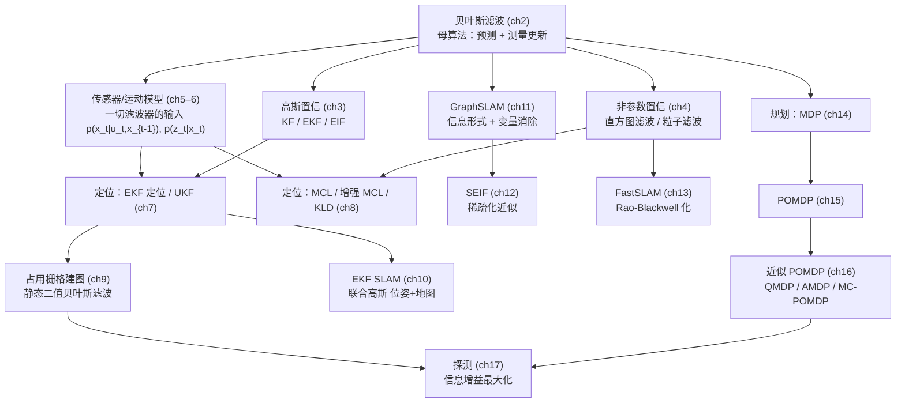

# 概率机器人 — 主题总览与教程框架（基于《概率机器人》中文版）

> 底本：Sebastian Thrun / Wolfram Burgard / Dieter Fox《Probabilistic Robotics》中文译本
> （机械工业出版社 2017，曹红玉等译，全书 4 部分 17 章，513 页）。
> 本地 PDF：`book/概率机器人-中文.pdf`（页码锚点：**PDF 页 = 书页 + 18**）。
> 教程目标：**逐章给出比原书更细的中文讲解**——每个核心知识点按仓库统一的
> [问题导向五步法](../../CONSTRAINTS.md)（问题场景 → 解决方法 → 选型理由 → **完整公式推导** → 反直觉点/适用边界）展开，
> 重点补足原书从略的推导中间步与代数细节。

---

## 1. 全书主线：一条"贝叶斯滤波"主线贯穿到底

概率机器人全书其实只讲一件事：**机器人如何在不确定性下估计状态并据此决策**。
所有算法都是同一个母算法——贝叶斯滤波——在不同置信表示（高斯 / 样本 / 直方图 / 信息形式）
与不同问题设定（定位 / 建图 / SLAM / 规划）下的具体化：



读通主线后可以看到三组"同构"：

1. **KF / EKF / EIF / GraphSLAM / SEIF** 同属高斯-信息家族：区别只是
   用矩（μ, Σ）还是信息（Ω, ξ）作参数，以及线性化与稀疏化策略；
2. **直方图滤波 / 粒子滤波 / MCL / FastSLAM** 同属非参数家族：
   区别是网格还是样本、建议分布怎么选；
3. **MDP / POMDP / 探测** 是把"估计"换成"决策"：贝尔曼最优性
   在完全能观测（MDP）与部分能观测（POMDP）两个层级上重演。

---

## 2. 统一记号表（全书教程共用，与原书一致）

| 记号 | 含义 |
|------|------|
| $x_t$ | 时刻 $t$ 的状态（位姿、地标位置等） |
| $u_t$ | 时刻 $t$ 施加的控制（运动指令 / 里程计读数） |
| $z_t$ | 时刻 $t$ 的测量（激光束、特征观测等） |
| $x_{1:t}, z_{1:t}, u_{1:t}$ | 从时刻 1 到 $t$ 的历史序列 |
| $\mathrm{bel}(x_t) = p(x_t \mid z_{1:t}, u_{1:t})$ | 后验置信分布 |
| $\overline{\mathrm{bel}}(x_t) = p(x_t \mid z_{1:t-1}, u_{1:t})$ | 预测（先验）置信分布 |
| $\mathcal{N}(x;\mu,\Sigma)$ | 均值 $\mu$、协方差 $\Sigma$ 的高斯密度 |
| $\Omega \triangleq \Sigma^{-1},\ \xi \triangleq \Sigma^{-1}\mu$ | 信息矩阵与信息向量 |
| $p(x_t \mid u_t, x_{t-1})$ | **运动（状态转移）模型**（ch5） |
| $p(z_t \mid x_t)$ 或 $p(z_t \mid x_t, m)$ | **测量模型**（ch6，建图时依赖地图 $m$） |
| $m = \{m_1, \dots, m_N\}$ | 地图（路标集合或栅格） |
| $c_t$ | 数据关联变量（测量对应的地标编号） |
| $\eta$ | 归一化常数 |
| $\mathcal{M}(x; a, b)$ | 区间 $[a,b]$ 上的均匀分布密度 |

约定：小写粗体略（原书用下标记号），矩阵用大写；推导中 $\propto$ 表示"正比于、常数因子由归一化吸收"。

---

## 3. 章节规划总表（17 章 → 17 篇教程）

| 篇 | 教程文件（拟） | 对应原书 | 书页 → PDF 页 | 一句话定位 |
|----|----------------|----------|----------------|------------|
| 01 | `01_绪论与概率机器人全景.md` | ch1 | 1→19 | 不确定性从哪来；概率范式为何胜出；全书地图 |
| 02 | `02_递归状态估计与贝叶斯滤波.md` | ch2 | 10→28 | ★母算法：贝叶斯滤波完整推导 + 门状态数值实例 |
| 03 | `03_高斯滤波_KF_EKF_EIF.md` | ch3 | 29→47 | 高斯代数四引理 → KF → 一阶线性化 → 信息形式 |
| 04 | `04_非参数滤波_直方图与粒子.md` | ch4 | 64→82 | 直方图离散化、log-odds 二值滤波、重要性采样 |
| 05 | `05_机器人运动模型.md` | ch5 | 88→106 | 速度模型与里程计模型：闭式密度 + 采样算法 |
| 06 | `06_机器人感知模型.md` | ch6 | 112→130 | 波束四分量混合、似然域、路标特征模型 |
| 07 | `07_马尔可夫定位与EKF定位.md` | ch7 | 142→160 | 三类定位问题；EKF 定位推导；马氏距离关联；UKF |
| 08 | `08_栅格定位与蒙特卡罗定位.md` | ch8 | 179→197 | MCL 全家桶：增强 MCL、KLD 自适应采样 |
| 09 | `09_占用栅格地图构建.md` | ch9 | 213→231 | log-odds 反演模型；正演模型 MAP 建图 |
| 10 | `10_EKF_SLAM.md` | ch10 | 235→253 | 联合高斯 位姿+地图；已知/未知数据关联 |
| 11 | `11_GraphSLAM.md` | ch11 | 258→276 | 全 SLAM 后验的信息形式；变量消除化为位姿问题 |
| 12 | `12_稀疏扩展信息滤波SEIF.md` | ch12 | 294→312 | 稀疏化=把地标先验化；支路定界数据关联 |
| 13 | `13_FastSLAM.md` | ch13 | 336→354 | Rao-Blackwell 分解；FastSLAM 2.0 改进建议分布 |
| 14 | `14_马尔可夫决策过程.md` | ch14 | 374→392 | 折扣回报、贝尔曼方程、值迭代收敛性 |
| 15 | `15_部分能观测马尔可夫决策过程.md` | ch15 | 394→412 | 置信空间值迭代；γ-备份；有限环境压缩与剪枝 |
| 16 | `16_近似POMDP技术.md` | ch16 | 421→439 | QMDP / AMDP / MC-POMDP 的近似假设对比 |
| 17 | `17_探测与整合探索.md` | ch17 | 438→456 | 信息增益/互信息；主动定位；整合探索机器人 |

> 写作顺序即编号顺序；每篇独立成文，但 02、03、04 三篇是全书的地基，篇幅与推导密度最大。

---

## 4. 各篇详细框架（核心公式 + 推导路线）

以下每篇给出：**锚点 → 学习目标 → 核心公式清单 → 推导路线（编号步骤，即教程正文的推导骨架）→ 关键算法 → 易错点**。
教程成文时将按五步法把"推导路线"逐步展开为带中间代数的完整过程。

### 01 绪论与概率机器人全景（ch1，书 1–9 页）

- **学习目标**：列举机器人不确定性的 5 个来源（环境/传感器/执行器/模型/近似算法）；
  说明"概率表示置信 + 贝叶斯更新"相对基于逻辑/规则方法的两大优势（容忍噪声、多假设并行）；
  建立"状态估计 → 定位 → SLAM → 规划"的问题金字塔。
- **重点内容**：1.3 节"启示"（概率机器人不是让你更不确定，而是让不确定性**可计算、可传播**）；
  1.4 节本书导航与我们 17 篇教程的对应关系。
- **易错点**：把概率机器人等同于"给输出加个置信度"；正解是**所有中间量都是分布**。

### 02 递归状态估计与贝叶斯滤波（ch2，书 10–27 页）★地基

- **学习目标**：从概率三公理出发徒手推出贝叶斯滤波；能对任意满足马尔可夫假设的问题写出预测/更新两步。
- **核心公式清单**：
  - 后验定义：$\mathrm{bel}(x_t) = p(x_t \mid z_{1:t}, u_{1:t})$；预测置信 $\overline{\mathrm{bel}}(x_t) = p(x_t \mid z_{1:t-1}, u_{1:t})$
  - 贝叶斯滤波（程序 2.1）：
    $$\overline{\mathrm{bel}}(x_t) = \int p(x_t \mid u_t, x_{t-1})\,\mathrm{bel}(x_{t-1})\, dx_{t-1}$$
    $$\mathrm{bel}(x_t) = \eta \, p(z_t \mid x_t)\, \overline{\mathrm{bel}}(x_t)$$
  - 全概率公式与条件概率定义（2.2 节）：$p(x) = \int p(x,y) dy$；$p(x\mid z) = \frac{p(x,z)}{p(z)}$
- **推导路线**（教程将逐步展开，原书 2.4.3 节的中间步补全）：
  1. 写出目标 $\mathrm{bel}(x_t) = p(x_t \mid z_{1:t}, u_{1:t-1}, u_t)$；
  2. 用条件概率分解把"最新测量 $z_t$"分离出来：$p(x_t \mid z_t, z_{1:t-1}, u_{1:t}) = \dfrac{p(z_t \mid x_t, z_{1:t-1}, u_{1:t})\, p(x_t \mid z_{1:t-1}, u_{1:t})}{p(z_t \mid z_{1:t-1}, u_{1:t})}$；
  3. **测量模型假设**：$z_t$ 与历史条件独立 → 分子第一项化为 $p(z_t\mid x_t)$，分母即 $\eta^{-1}$；
  4. 对预测项做条件展开 $p(x_t, x_{t-1} \mid z_{1:t-1}, u_{1:t}) = p(x_t \mid x_{t-1}, z_{1:t-1}, u_{1:t})\, p(x_{t-1} \mid z_{1:t-1}, u_{1:t})$ 后积分；
  5. **运动模型假设**：$p(x_t \mid x_{t-1}, u_t)$ 与更早历史独立；$p(x_{t-1} \mid z_{1:t-1}, u_{1:t-1}) = \mathrm{bel}(x_{t-1})$（$u_t$ 不改变过去）→ 得预测积分式；
  6. 合并两步得贝叶斯滤波；讨论 2.4.4 节马尔可夫假设的三条兑现条件（状态完备、静态环境、独立噪声）与"弱化假设也能活"的工程现实。
- **关键实例**：门状态估计（书 21–25 页）——用 2 状态离散滤波手算 5 轮"感知-动作-感知"，
  体会"收敛"、"动作引入熵、测量消除熵"、"矛盾测量下的多峰"三种现象。
- **易错点**：①预测在测量之前（时序别排错）；②连续状态下 $\eta$ 不是 1；
  ③马尔可夫假设被违反（动态障碍物）时滤波仍可用但会系统性偏移。

### 03 高斯滤波：KF / EKF / EIF（ch3，书 29–63 页）★地基

- **学习目标**：掌握高斯变量的四个代数引理；从贝叶斯滤波闭式推出 KF；
  用一阶泰勒展开推 EKF；把 KF 重写成信息形式并理解其"加法友好"特性。
- **核心公式清单**：
  - 高斯密度：$p(x) = (2\pi)^{-n/2}\det\Sigma^{-1/2}\exp\left(-\tfrac12 (x-\mu)^T\Sigma^{-1}(x-\mu)\right)$
  - **线性高斯系统的矩传播**（引理，书 42–44 页）：若 $x \sim \mathcal{N}(\mu,\Sigma)$，则
    $x' = Ax + b + \varepsilon,\ \varepsilon \sim \mathcal{N}(0,R) \Rightarrow x' \sim \mathcal{N}(A\mu+b,\ A\Sigma A^T + R)$
  - KF 预测：$\bar\mu_t = A_t\mu_{t-1} + B_tu_t$；$\bar\Sigma_t = A_t\Sigma_{t-1}A_t^T + R_t$
  - KF 更新：$K_t = \bar\Sigma_t C_t^T(C_t\bar\Sigma_t C_t^T + Q_t)^{-1}$；
    $\mu_t = \bar\mu_t + K_t(z_t - C_t\bar\mu_t)$；$\Sigma_t = (I - K_tC_t)\bar\Sigma_t$
  - EKF 线性化：$x_t \approx f(u_t,\mu_{t-1}) + F_{t,n}(x_{t-1}-\mu_{t-1}) + w_t$，$F_{t,n} = \left.\frac{\partial f}{\partial x}\right|_{\mu_{t-1}}$；
    测量侧 $z_t \approx h(\bar\mu_t) + H_t(x_t - \bar\mu_t) + v_t$
  - 信息形式：$\Omega = \Sigma^{-1},\ \xi = \Sigma^{-1}\mu$；IF 更新是**信息相加**：$\Omega_t = \bar\Omega_t + C^TQ^{-1}C$，$\xi_t = \bar\xi_t + C^TQ^{-1}z$
- **推导路线**：
  1. 证高斯四引理：边缘化、条件化、线性变换、两个高斯乘积（配平方完成平方/square completion）；
  2. 假设 $\mathrm{bel}(x)$ 为高斯 + 线性高斯运动/测量模型 → 预测步直接代矩传播引理；
  3. 更新步用"高斯乘积引理"或联合高斯条件化两条路各推一遍（原书用后者），比较两条路，体会 $K_t$ 的来历（新息加权）；
  4. EKF：对非线性 $f, h$ 在当前估计处一阶泰勒展开，逐行替换 KF 中的 $A, C$；讨论为何预测步在 $\mu_{t-1}$ 处展开、更新步在 $\bar\mu_t$ 处展开（各自是当前最优的高斯中心）；
  5. EIF：把矩参数换成信息参数，重推预测/更新；指出更新在信息形式下变成加法（多传感器融合的天然形式），预测则变难（需 $\Omega^{-1}$）；
  6. EIF → EIF：非线性处重新线性化（区别于 EKF 的"只在预测步线性化"）。
- **易错点**：①EKF 的雅可比点选错（不是在"真值"处展开——真值未知）；②协方差对称正定在数值上会被打破，工程上要 $0.5(\Sigma+\Sigma^T)$ 或对称化；③KF 一致性（$\mathrm{trace}$ 收缩）不等于无偏。

### 04 非参数滤波：直方图与粒子（ch4，书 64–87 页）★地基

- **学习目标**：理解"贝叶斯滤波的置信表示不一定是高斯"；
  掌握离散贝叶斯滤波、静态二值滤波的 log-odds 形式（ch9 占用建图的直接前置）；
  从重要性采样推出粒子滤波并解释重采样的必要性。
- **核心公式清单**：
  - 离散贝叶斯滤波（直方图，程序 4.1）：$p_{k,t} = \eta \sum_i p(x_k \mid u_t, x_i)\, p_{i,t-1}$（测量步 $p_{k,t} \leftarrow \eta\, p(z_t \mid x_k) p_{k,t}$）
  - 连续状态矩形近似：$p_{k,t} \approx \int_{x_{k-1}}^{x_k} p(x)\,dx \approx p(x_k)(x_k - x_{k-1})$
  - 静态二值贝叶斯滤波（4.2 节，对数几率形式）：
    $$l_t = \log \frac{p_t}{1-p_t}, \qquad l_t = l_{t-1} + \log\frac{p(z_t \mid x)}{p(z_t \mid \bar x)} - l_0$$
    （$l_0$ 项：先验只进一次，防重复计数——占用建图算法 9.1 的核心行）
  - 重要性采样：$\mathrm{bel}(x_t) \approx \frac{1}{N}\sum_i \omega_t^{(i)} \delta(x_t - x_t^{(i)})$，权重递推
    $$\omega_t^{(i)} \propto \frac{p(z_t \mid x_t^{(i)})\, p(x_t^{(i)} \mid u_t, x_{t-1}^{(i)})}{\pi(x_t^{(i)} \mid x_{t-1}^{(i)}, z_t, u_t)}\, \omega_{t-1}^{(i)}$$
- **推导路线**：
  1. 直方图滤波 = 把贝叶斯滤波的积分换成网格求和；推矩形近似的偏差阶（分辨率减半误差如何变化）；
  2. 静态二值滤波：对静态世界（$p(x_t \mid u_t, x_{t-1}) = \delta(x_t - x_{t-1})$）化简贝叶斯滤波；两边取 log 得乘法变加法；解释 $l_0$ 项的来源（否则同一测量被反复计入）；
  3. 粒子滤波：写目标 $\mathrm{bel}(x_t)$ → 无法直接采样（$p(z_t|x_t)p(x_t|u_t,x_{t-1})$ 非标准形）→ 引入建议分布 $\pi$ 与重要性权重 $\omega \propto p/\pi$；
  4. 归纳法推权重递推式（原书 4.3.3 节的关键代数补全）；
  5. 退化（degeneracy）：权重方差随时间单调增大 → 有效样本数 $N_{\mathrm{eff}} \approx 1/\sum_i (\omega^{(i)})^2$ → 重采样步骤及其引入的样本贫化；
  6. 讨论建议分布两种常见选择：运动模型本身 $\pi = p(x_t|u_t,x_{t-1})$（MCL 用这个，权重只剩 $p(z_t|x_t)$）与改进建议（ch13 FastSLAM 2.0 预告）。
- **易错点**：①重采样前不归一化权重；②log-odds 累加时忘记减 $l_0$（会随时间无限漂移）；
  ③粒子数固定不变——ch8 的 KLD 采样会给出"按熵调粒子数"的解法。

### 05 机器人运动模型（ch5，书 88–111 页）

- **学习目标**：写出两种主流运动模型（速度/里程计）的闭式密度与采样算法；
  理解噪声参数 $\alpha_1..\alpha_6$ / $\beta_1..\beta_6$ 的物理含义与调参方向。
- **核心公式清单**：
  - 速度模型状态转移（圆弧 + 旋转）：由 $(x, y, \theta)$ 与 $(v, \omega)$、时延 $\delta t$ 给出
    $$x' = x + \frac{v}{\omega}(-\sin\theta + \sin(\theta + \omega\delta t)),\quad
      y' = y + \frac{v}{\omega}(\cos\theta - \cos(\theta + \omega\delta t)),\quad
      \theta' = \theta + \omega\delta t$$
  - 闭式密度：反解 $\hat v, \hat\omega = g(x', x)$，令 $\varepsilon$ 为零均值高斯残差，
    $p(x_t \mid u_t, x_{t-1}) = \mathcal{N}(\varepsilon; 0, M(\hat v, \hat\omega))$，噪声协方差对角阵
    $M = \mathrm{diag}(\alpha_1\hat v^2 + \alpha_2\hat\omega^2,\ \alpha_3\hat v^2 + \alpha_4\hat\omega^2,\ \alpha_5\hat v^2 + \alpha_6\hat\omega^2)$
  - 速度采样算法（程序 5.2）：$v = \hat v + \mathrm{sample}(\alpha_1\hat v^2 + \alpha_2\hat\omega^2)$ 等
  - 里程计模型三段分解：$\delta_{\mathrm{rot1}}, \delta_{\mathrm{trans}}, \delta_{\mathrm{rot2}}$，噪声 $\beta_1..\beta_6$
- **推导路线**：
  1. 由常角速度积分推出圆弧闭式解（补全原书跳过的积分）；
  2. 闭式密度法：给定起终点反解 $(\hat v, \hat\omega, \hat\gamma)$，把"模型-观测差"当高斯噪声 → 得 $p(x'|x,u)$；
  3. 采样法：直接在控制量上加噪再前向积分——解释为什么**滤波实践偏爱采样版**（粒子滤波天然需要采样，闭式密度仅 EKF 定位需要）；
  4. 里程计模型：由两次位姿读数求 $\delta_{\mathrm{rot1}}, \delta_{\mathrm{trans}}, \delta_{\mathrm{rot2}}$，推导其概率密度与采样变体；对比两者：速度模型适配"控制已知"场景，里程计模型经验上误差更小（读数即近似的真实运动）。
- **易错点**：①$\omega \to 0$ 时圆弧退化直线的数值问题（原书算法用 $\mathrm{diff}$ 处理）；②$\alpha$ 参数盲目调——应按"平移误差∝平移²，旋转误差∝旋转²+平移"分解实测定标；③里程计的 $\delta_{\mathrm{rot1}}$ 要做角度归一化到 $(-\pi, \pi]$。

### 06 机器人感知模型（ch6，书 112–141 页）

- **学习目标**：掌握激光波束模型的四分量混合及其参数学习；会用似然域模型（实践首选）；
  会写路标特征模型（SLAM 部分的基础）。
- **核心公式清单**：
  - 波束模型（4 分量混合）：
    $$p(z \mid x, m) = \begin{pmatrix} z_{\mathrm{hit}} \\ z_{\mathrm{short}} \\ z_{\mathrm{max}} \\ z_{\mathrm{rand}} \end{pmatrix}^T
      \begin{pmatrix} p_{\mathrm{hit}} \\ p_{\mathrm{short}} \\ p_{\mathrm{max}} \\ p_{\mathrm{rand}} \end{pmatrix},\quad
      \sum z_i = 1$$
    其中 $p_{\mathrm{hit}} = \mathcal{N}(z; z^{k*}, \sigma_{\mathrm{hit}}^2)$，
    $p_{\mathrm{short}} = \lambda e^{-\lambda z}$（意外障碍），$p_{\mathrm{max}} = [z = z_{\max}]$（尖峰），
    $p_{\mathrm{rand}} = \frac1{z_{\max}}$（均匀噪声）
  - 参数最大似然学习（6.3.2）：辅助量 $\eta = (N + n)^{-1}$ 的期望最大化更新式
  - 似然域模型（6.4）：
    $$p(z^k \mid x, m) = z_{\mathrm{hit}} \sum_j \mathcal{N}(\mathrm{dist}_{\mathcal{T}(\mathrm{ring})}; 0, \sigma^2) + z_{\mathrm{rand}}\frac1{z_{\max}}$$
  - 路标模型（已知对应 $c$）：$p(z_t \mid x_t, m) = \mathcal{N}(z_t - \hat z_t, Q_t)$，
    $\hat z = h(x, m, c) = \begin{pmatrix} \sqrt{d_x^2 + d_y^2} \\ \arctan 2(d_y, d_x) - \theta \end{pmatrix}$
- **推导路线**：
  1. 逐分量讲物理来源（真命中 / 障碍物突然消失于视野 / 超量程 / 串扰）；
  2. 推参数学习：固定 $E$（真命中）与 $F$（意外障碍）两个隐变量，写出对数似然对 $z_{\mathrm{hit}}$ 等的偏导并置零（原书 6.3.2 的表格推导展开）；
  3. 似然域：把测量端点经位姿变换 $\mathcal{T}$ 投到地图，在"最近障碍物端点"处放高斯核——解释为何**丢掉角度信息却更鲁棒**（无对应/特征缺失时不易发散）；
  4. 路标模型：由位姿+路标位置推观测预测 $\hat z$ 及其雅可比 $\nabla h$（ch7 EKF 定位直接要用）。
- **易错点**：①波束模型对地图分辨率与位姿误差极敏感（教材明确说实践中被似然域取代）；
  ②似然域的"最近点"搜索要限最大搜索半径（平滑性）；③角测量要 atan2 与角度归一化。

### 07 马尔可夫定位与 EKF 定位（ch7，书 142–178 页）

- **学习目标**：区分三类定位问题（全局定位 / 位姿跟踪 / 绑架）；完整推 EKF 定位；
  掌握基于马氏距离的 ML 数据关联与一致性检验；了解 MHT 与 UKF 两条扩展线。
- **核心公式清单**：
  - EKF 定位预测：$\bar\mu_t = f(\mu_{t-1}, u_t)$，$\bar\Sigma_t = F_{t-1}\Sigma_{t-1}F_{t-1}^T + R_t$（$F_{t-1}$ 是 $f$ 对位姿的雅可比，注意 3×(3+2N) 的稀疏结构）
  - EKF 定位更新（已知对应 $c_t$）：
    $$K_t = \bar\Sigma_t H_t^T(H_t\bar\Sigma_t H_t^T + Q_t)^{-1},\quad \mu_t = \bar\mu_t + K_t(z_t - \hat z_t),\quad \Sigma_t = (I - K_tH_t)\bar\Sigma_t$$
  - ML 数据关联得分（马氏距离）：
    $$d_{t,c} = (z_t - \hat z_{t,c})^T S_{t,c}^{-1}(z_t - \hat z_{t,c}) \le \chi^2_{2, 0.95} \approx 5.99$$
  - UKF sigma 点：$\mathcal{X}^{(i)} = \mu \pm \sqrt{(n+\lambda)\Sigma}$ 行，$\lambda = \alpha^2(n+\kappa) - n$
- **推导路线**：
  1. 把马尔可夫定位写成"贝叶斯滤波 + 任意置信表示"，讨论三种初始化（均匀=全局定位、高斯=跟踪、双峰=走廊对称性）；
  2. EKF 定位推导：直接沿用 ch3 框架，但 $f$ 取 ch5 运动模型、$h$ 取 ch6 路标模型——**ch3/5/6 三章在此合流**；
  3. 数据关联：对每个候选路标算马氏距离，取最小者；推导一致性检验（若关联正确，新息应服从 $\chi^2(k)$，查表阈值 5.991@2D 95%）；
  4. MHT：多假设并行传播，测量到来时按贝叶斯更新各假设后验概率；
  5. UKF：无迹变换替代线性化，推 sigma 点权重 $\omega^{(i)}$ 与均值/协方差恢复公式，对比 EKF 误差阶（二阶 vs 一阶）。
- **易错点**：①关联错误被滤波器"吸收"成发散——门限宁可紧；②全局定位时初始均匀分布下 EKF 无从谈线性化（要用 MCL 先收敛）；③UKF 的 $\alpha, \kappa$ 取值影响高阶矩捕捉。

### 08 栅格定位与蒙特卡罗定位（ch8，书 179–212 页）

- **学习目标**：实现栅格定位与标准 MCL；掌握两个著名改进——增强 MCL（绑架恢复）与 KLD 采样（粒子数自适应）。
- **核心公式清单**：
  - MCL（程序 8.3）：采样 $x_t^{(i)} \sim p(x_t \mid u_t, x_{t-1}^{(i)})$，权重 $\omega^{(i)} = p(z_t \mid x_t^{(i)})$，重采样
  - 增强 MCL 注入随机粒子概率：
    $$\max\left(0,\ 1 - \frac{\omega_{\mathrm{fast}}}{\omega_{\mathrm{slow}}}\right),\qquad
      \omega_{\mathrm{slow}} \mathrel{+}= \alpha_{\mathrm{slow}}(\bar\omega - \omega_{\mathrm{slow}}),\quad
      \omega_{\mathrm{fast}} \mathrel{+}= \alpha_{\mathrm{fast}}(\bar\omega - \omega_{\mathrm{fast}})$$
    （$\alpha_{\mathrm{slow}} \ll \alpha_{\mathrm{fast}}$，权重突降 → 大量注入随机粒子 → 覆盖多峰）
  - KLD 采样样本数（Wilson–Hilferty 近似）：
    $$n = \frac{1}{2\varepsilon}\chi^2_{k-1, 1-\delta} \approx \frac{k-1}{2\varepsilon}\left(1 - \frac{2}{9(k-1)} + \sqrt{\frac{2}{9(k-1)}}\, z_{1-\delta}\right)^3$$
- **推导路线**：
  1. 栅格定位 = 直方图滤波 + 定位；离散卷积实现运动更新（及其 FFT 加速，仅提及）；
  2. MCL = ch4 粒子滤波 + ch5 运动模型 + ch6 测量模型的拼装，逐行对照程序 8.3；
  3. 增强 MCL：把 $\omega_{\mathrm{slow/fast}}$ 当两个一阶低通滤波器，推"瞬时平均权重骤降 ⇒ 比值骤升 ⇒ 注入概率骤升"的因果链；
  4. KLD：把粒子集看成对置信直方图的抽样，要求"非空格子的经验分布与真分布 KL 距离 $< \varepsilon$"（置信 $1-\delta$），由 $\chi^2$ 分布推样本界；解释 $k$ 随收敛而减小 → 粒子数自动下降。
- **易错点**：①重采样在低权重时刻（如刚开机测量噪声大）会立刻导致多样性崩溃——增强 MCL 的 $\alpha$ 比值必须配平；②KLD 的 $k$ 是"当前非空格子数"，实现时逐粒子更新。

### 09 占用栅格地图构建（ch9，书 213–234 页）

- **学习目标**：推静态二值滤波的 log-odds 增量形式（ch4 知识的第一次大型实战）；
  理解反演模型与正演模型的本质区别；会用正演模型做 MAP 建图解决"依赖性丢失"问题。
- **核心公式清单**：
  - 静态世界贝叶斯滤波：$p(m \mid z_{1:t}, x_{1:t}) = \left(1 + \frac{p(m \mid z_{1:t-1}, x_{1:t-1})}{1 - p(m \mid z_{1:t-1}, x_{1:t-1})}\cdot\frac{1 - p(m \mid z_t, x_t)}{p(m \mid z_t, x_t)}\right)^{-1}$
  - log-odds 增量形式（算法 9.1 核心）：
    $$l_{t,i} = l_{t-1,i} + \log\frac{p(m_i \mid z_t, x_t)}{1 - p(m_i \mid z_t, x_t)} - l_{0,i}$$
    恢复概率 $p(m_i \mid z_{1:t}, x_{1:t}) = 1 - (1 + e^{l_{t,i}})^{-1}$
  - MAP 建图（正演模型，9.4 节）：
    $$m^* = \arg\max_m \prod_t \int p(z_t \mid x_t, m)\, p(x_t)\, dx_t$$
- **推导路线**：
  1. 写"已知位姿 + 已知对应"的静态二值滤波（$u_t$ 消失，位姿作为条件变量）；
  2. 用贝叶斯准则 + 全概率推 odds 递推（原书 9.2 节公式逐步展开），取 log；
  3. **反演模型** $p(m_i \mid z_t, x_t)$ 的构造：射线覆盖格子赋 0.4、末端格子赋 0.6+、其余 0.5——强调它**不是**传感器模型 $p(z|m)$ 的逆，而是一个为方便设计的启发式（其名字有误导性，教程将专门辨析）；
  4. 指出 log-odds 累加隐含"格子间独立 + 测量重复计数"两个近似 → 理论病灶；
  5. MAP 建图：改用**正演模型**（真正的 $p(z|x,m)$，如光线投射测距模型），对数后验对地图求导，得逐格子期望占据量的迭代式（原书 9.4.2 的推导展开）。
- **易错点**：①$-l_0$ 忘减 → 已见区域随时间无限变黑/白；②反演模型赋值 0.4/0.6 是工程值不是定理；
  ③占用概率 0.5 = 无信息，不是"不知道占不占"的均匀先验问题（无信息应为 log-odds 0）。

### 10 EKF SLAM（ch10，书 235–257 页）

- **学习目标**：把定位的 EKF 扩张为"位姿+全地图"联合状态；推联合预测/更新；
  理解协方差矩阵的物理意义（一切不确定性相关）；掌握未知数据关联下的 SLAM。
- **核心公式清单**：
  - 联合状态：$\mu_t = \begin{pmatrix} x_{r,t} \\ m_{1,t} \\ \vdots \\ m_{N,t}\end{pmatrix}$，协方差按块结构
    $$\Sigma_t = \begin{pmatrix} \Sigma_{r,r} & \Sigma_{r,m} \\ \Sigma_{m,r} & \Sigma_{m,m} \end{pmatrix}$$
  - EKF SLAM 预测：$\bar\mu_t = f(\mu_{t-1}, u_t)$（仅位姿块更新，地标块不变），雅可比
    $$F_{t-1} = \begin{pmatrix} F_{1,1} & 0 \\ F_{2,1} & I \end{pmatrix}$$
  - 更新（复用 ch7 式，$H_t$ 有 2×(3+2N) 稀疏结构）
  - 未知关联的一致性检验：$E_t(c) = (\mu - \bar\mu)^T S_c^{-1}(\mu - \bar\mu)$（思想：假设 $c$ 正确，更新后位姿应"不动"）
- **推导路线**：
  1. 定义全 SLAM 状态与联合高斯假设，画协方差块结构图（机器人-地标、地标-地标块非零的来源）；
  2. 预测：运动只作用于位姿块，但因交叉块 $\Sigma_{r,m}$ 存在，地标不确定性也随之增大——把这一条算给读者看；
  3. 更新：复用 EKF 公式，展开 $H_t$ 的非零列（只涉及被观测地标对应列 + 位姿列）；
  4. 未知对应：对每个候选 $c$ 执行"假想更新"算 $E_t(c)$，取最小者并作 $\chi^2$ 检验；
  5. 地图管理：何时把观测固化为新地标（单帧 vs 多帧确认），讨论虚假地标抑制。
- **易错点**：①EKF SLAM 的复杂度 $O(N^2)$（协方差稠密）——这是 ch11/12/13 三章的动机；
  ②非线性位姿模型下长期一致性会退化（原书 10.3 讨论）；③关联阈值放太松 → 错误闭环全图崩。

### 11 GraphSLAM（ch11，书 258–293 页）

- **学习目标**：理解"全 SLAM 后验的信息形式 = 因子图"；推变量消除如何把 $3t + 2N$ 维问题化成 $3t$ 维；
  体会信息矩阵稀疏性与图结构的对偶。
- **核心公式清单**：
  - 全 SLAM 后验：$p(x_{1:t}, m \mid z_{1:t}, u_{1:t})$（注意与 ch10 的 online 后验不同——多了整条路径）
  - 信息形式（由高斯后验倒数变换）：$\Omega_t = \Sigma_t^{-1},\ \xi_t = \Sigma_t^{-1}\mu_t$，
    $\mathcal{N}(\mu, \Sigma) \propto \exp\left(-\tfrac12 \mu^T\Omega\mu + \xi^T\mu\right)$
  - 约束叠加（图构建核心）：每条运动边/测量边贡献信息块**直接相加**
  - 变量消除（11.4 节核心引理）：
    $$\int \exp\left(-\tfrac12 x_j^T\Omega_{jj}x_j + (c_j - \Omega_{ji}x_i)^Tx_j\right) dx_j
      \propto \exp\left(-\tfrac12 x_i^T(\Omega_{ii} - \Omega_{ij}\Omega_{jj}^{-1}\Omega_{ji})x_i + (c_i - \Omega_{ij}\Omega_{jj}^{-1}c_j)^Tx_i\right)$$
  - 求解：$(\Omega + \dots)\mu = \xi$ 的线性方程（Cholesky）
- **推导路线**：
  1. 从全 SLAM 后验出发，高斯假设下取对数得二次型 → 信息矩阵/向量即"图上因子的相加"；
  2. 画因子图（位姿节点、地标节点、运动因子、测量因子）；
  3. 变量消除推导（上式配平方展开——教程将完整展开这个"Schur 补"式引理）；
  4. 消除全部地标 → 剩 $3t \times 3t$ 的位姿信息矩阵，解出路径；
  5. 路径恢复：把解出的位姿回代，得每个地标的条件高斯（均值/协方差恢复公式）；
  6. 数据关联：在信息形式下推一致性测试（11.5.2 节），介绍贪心与"迭代-关联-优化"外循环。
- **易错点**：①GraphSLAM 处理的是**全**后验，与 EKF SLAM 的 online 后验做公式对比时别混；
  ②信息矩阵奇异（无先验时全局锚定缺失）→ 加自由度约束或固定首帧；
  ③稀疏性来自"单次测量只连 2 个节点"，别把稠密协方差的直觉带过来。

### 12 稀疏扩展信息滤波 SEIF（ch12，书 294–335 页）

- **学习目标**：理解 SEIF 与 GraphSLAM 的关系（同族但 online、近似稀疏化）；
  推"稀疏化 = 把地标先验化"；了解支路定界数据关联。
- **核心公式清单**：
  - SEIF 预测/更新（信息形式 + 非线性重线性化）
  - 稀疏化（12.5 节核心）：选定活跃地标集 $a$，把其余视为隐变量消除：
    $$\Omega_{\mathrm{new}} = \Omega_{aa} - \Omega_{am}\Omega_{mm}^{-1}\Omega_{ma},\quad
      \xi_{\mathrm{new}} = \xi_a - \Omega_{am}\Omega_{mm}^{-1}\xi_m$$
    再将"因消除而新增的连接"按对角近似吸收回对角块
  - 支路定界（12.9）：用信息矩阵元素上界作分支定界的剪枝准则
- **推导路线**：
  1. 写 SEIF 的预测/更新算法（对比 EKF SLAM：更新同样 $O(1)$，预测不再破坏稀疏性是关键创新）；
  2. 稀疏化推导：把非活跃地标 $m$ 当作"要边缘化掉的变量"，套用 ch11 变量消除引理；
    严格边缘化会引入稠密性 → 采用"对角近似"（把 $-\Omega_{am}\Omega_{mm}^{-1}\Omega_{ma}$ 的非对角项丢弃）保稀疏——明确告诉读者这是**有偏近似**；
  3. 分期偿还地图恢复（12.6）：一次消除多个地标、分摊到多个时间步；
  4. 支路定界：给出递归搜索伪代码与界不等式的推导。
- **易错点**：①稀疏化后信息矩阵不再对应任何真实高斯（信息量被丢弃）——收敛性无保证；
  ②活跃集选择影响精度（原书 12.7 节经验规律）；③SEIF 在现代实践中已被图优化取代，学习价值在思想（信息稀疏性）。

### 13 FastSLAM（ch13，书 336–373 页）

- **学习目标**：推 Rao-Blackwell 分解（全书最优雅的一条推导）；
  掌握 FastSLAM 1.0→2.0 的建议分布改进动机与公式；了解树实现与栅格 FastSLAM。
- **核心公式清单**：
  - 条件独立引理（13.2 节）：已知路径时地标相互独立
    $$p(x_{1:t}, m \mid z_{1:t}, u_{1:t}) = p(x_{1:t} \mid z_{1:t}, u_{1:t})\prod_i p(m_i \mid x_{1:t}, z_{1:t})$$
  - 每粒子地标估计：$p(m_i \mid x_{1:t}, z_{1:t}) = \mathcal{N}(\mu_{n,t}^{(i)}, \Sigma_{n,t}^{(i)})$（EKF 单点更新！）
  - FastSLAM 1.0 建议分布 = 运动模型；权重 $\omega^{(i)} \propto p(z_t \mid x_t^{(i)}, \mu_{n,t}^{(i)})$
  - FastSLAM 2.0 建议分布（纳入 $z_t$ 的高斯）：
    $$\pi(x_t \mid \cdot) = \mathcal{N}\left(\mu_t^{(i)},\ \Sigma_t^{(i)}\right),\quad
      \Sigma_t^{(i)} = \left((\bar\Sigma_t^{(i)})^{-1} + H_t^T (R_t)^{-1} H_t\right)^{-1}$$
  - 高效地标更新（KF 单地标更新，$O(1)$）与树结构 $O(\log N)$
- **推导路线**：
  1. 证条件独立引理：地图先验分解 + 测量模型只依赖单一地标 → 按链式法则逐项拆（原书 13.2.1 展开补全）；
  2. 证"已知路径时每地标的估计是线性高斯问题"→ EKF 闭式；**复杂度从 EKF SLAM 的 $O(N^2)$ 降到 $O(N \log N)$（每粒子）**；
  3. FastSLAM 1.0：套 ch4 粒子滤波框架，路径粒子 + 每粒子独立地标高斯；
  4. 指出 1.0 的病灶：运动模型噪声大时建议分布与真后验失配（路径粒子漂移，地标估计跟着错）；
  5. FastSLAM 2.0：推改进建议分布（把 $p(z_t | x_t)$ 吸收进 $\pi$，得高斯 $\mathcal{N}(\mu_t^{(i)}, \Sigma_t^{(i)})$，采样后权重含"新息马氏项"的倒数）；
  6. 闭环：重访旧地标时的均值/协方差更新（协方差收缩）与树结构上的多地标更新。
- **易错点**：①粒子数不足时地标估计多样性不足 → 闭环后地图模糊（原书 13.9 经验）；②2.0 的权重公式含建议分布项，实现时别只乘 $p(z|x)$；③树实现中重采样后仍要复用节点（否则 $O(N)$ 地标丢失）。

### 14 马尔可夫决策过程（ch14，书 374–393 页）

- **学习目标**：建立"策略=置信到动作的映射"的决策观；推值迭代收敛性与最优策略提取；能对抓取/导航建模 MDP。
- **核心公式清单**：
  - 折扣回报：$V^\pi = E\left[\sum_t \gamma^t R(s_t)\right]$，$0 \le \gamma < 1$
  - 贝尔曼最优方程：$U(s) = R(s) + \gamma \max_a \sum_{s'} T(s, a, s') U(s')$
  - 值迭代（程序 14.2）与策略提取：$\pi^*(s) = \arg\max_a \sum_{s'} T(s,a,s') U(s')$
  - 收敛性（压缩映射）：$\|U_{k+1} - U_k\|_\infty \le \gamma^k \|U_1 - U_0\|_\infty$，误差界 $\|U - U_k\| \le \frac{\gamma^k}{1-\gamma}\|U_1-U_0\|$
- **推导路线**：
  1. 从"动作后果随机"写期望回报，引入折扣（保证无穷级数收敛 + 偏好近期）；
  2. 用动态规划最优化原理推贝尔曼方程；
  3. 证值算子是 $\gamma$-压缩映射（逐范数三角不等式展开）→ 不动点唯一、迭代收敛；
  4. 策略提取与策略迭代（提及）；机器人应用：抓取的 MDP 化（书 14.4）。
- **易错点**：①$\gamma \to 1$ 收敛极慢；②奖励设计决定策略好坏（稀疏奖励问题）；③MDP 假设**完全能观测**——机器人不满足，这正是 ch15 的出发点。

### 15 POMDP（ch15，书 394–420 页）

- **学习目标**：把值迭代搬到置信空间；推广义备份公式；掌握有限环境压缩与剪枝。
- **核心公式清单**：
  - 置信更新（ch2 的直接复用）：$p(x' \mid b, \gamma, z) = \eta\, p(z \mid x') \sum_x p(x' \mid x, \gamma) b(x)$
  - 置信空间值函数：$U(b) = \max_\gamma \left[ r(b, \gamma) + \int U\big(T(b, \gamma, z)\big)\, p(z \mid b, \gamma)\, dz \right]$
  - γ-表示：$U$ 是一组超平面 $\{\gamma\}$ 的分段线性凸包，$U(b) = \max_\gamma \gamma^T b$
  - 有限环境无损压缩（15.3）：把可达置信空间切成"策略等价"的格子
- **推导路线**：
  1. 写 POMDP 五元组，定义置信空间上的诱导 MDP（状态=分布！）；
  2. 推广义备份：把 ch14 贝尔曼方程中的 $T$ 换成置信转移 $T(b, \gamma, z)$，注意动作效用 $r(b,\gamma) = \sum_x R(x, \gamma) b(x)$ 对 $b$ 线性；
  3. 由"线性 + max"推 γ-超平面表示与分段线性凸性（PLCV）→ 给出可计算的备份算子（枚举 γ 组合）；
  4. 复杂度爆炸（超平面数指数增长）→ 无损/有损压缩（15.3）+ 剪枝（被支配 γ 删除）；
  5. 精确算法只在小问题可行 → 引出 ch16 近似方法。
- **易错点**：①POMDP 的"状态"是置信分布，维度是 $|S|$ 维连续空间——不要按离散状态想；
  ②γ-表示只在有限视界/折扣下成立；③备份的组合爆炸是工程上限。

### 16 近似 POMDP 技术（ch16，书 421–437 页）

- **学习目标**：掌握三个近似层级各自"丢弃了什么"，能在工程中选型。
- **核心公式清单**：
  - QMDP：$U(s, b) = \sum_s b(s) \max_a \sum_{s'} T(s,a,s')\left[R(s,a,s') + \gamma \sum_{s''} T(s', z) \right]$（思想：假设**下一时刻起全观测**，退化为 ch14 MDP）
  - AMDP（增广 MDP，16.3）：把置信摘要 $b$ 的统计量并入状态空间 $x = (s, \bar b)$ 建模 MDP
  - MC-POMDP（16.4）：粒子置信 + "粒子→动作"随机映射，α 向量按粒子对回归（式 16.22 附近）
- **推导路线**：
  1. QMDP：从精确备份出发，把 $U(T(b,\gamma,z))$ 项用"下一时刻完全能观测"的上界替换——推导其近似方向（多数情形偏乐观）；
  2. AMDP：推增广状态下的贝尔曼方程，讨论摘要特征怎么选（均值、熵、目标距离）；
  3. MC-POMDP：粒子近似置信空间，推置信点上的 γ 回归（最小二乘拟合），对照书 16.4.3 推导；
  4. 三者对比表：计算量 / 最优性损失 / 适用场景（QMDP 适合"看一眼就清楚"的环境；MC-POMDP 适合长时程信息收集）。
- **易错点**：QMDP 在"必须提前规划信息获取动作"的场景会系统性失败（如黑暗中找门）；这不是 bug 而是近似假设本身。

### 17 探测与整合探索（ch17，书 438–467 页）

- **学习目标**：把"探索"形式化为信息增益最大化；掌握增益/互信息计算与主动定位；理解整合探索的折中结构。
- **核心公式清单**：
  - 信息增益（17.2.1）：
    $$I(\gamma) = \sum_{x,z} p(x) p(z \mid x, \gamma) \log \frac{p(x \mid z, \gamma)}{p(x)} = I(x; z) \ \ (\text{互信息})$$
    连续形式 $I = H(p(x)) - E_{p(z)}[H(p(x \mid z, \gamma))]$，$H(p) = -\int p \log p\, dx$
  - 互信息对称性：$I(x;z) = \mathrm{KL}\big(p(x,z) \,\|\, p(x)p(z)\big) \ge 0$
  - 整合探索效用：$U^* = \max \left[ \alpha \cdot (\text{信息增益}) + (1-\alpha)\cdot(\text{定位质量/目标效用}) \right]$
- **推导路线**：
  1. 从"动作改变未来能获得的信息"定义增益，推其等于互信息（用 $I = H(x) - H(x|z)$ 与贝叶斯准则展开）；
  2. 主动定位：MCL 粒子上计算候选动作的期望熵降（书 17.3 的实现细节）；
  3. 占用栅格探测：栅格独立假设下熵可分解求和，推增益计算（17.4.1）与增益沿测量射线的传播近似（17.4.2，把多步规划摊成单步代价）；
  4. 整合探索（17.5）：ELIYAHU 系统实例——"定位不确定性高时倾向看向地标、低时倾向探新区域"的效用权重调度。
- **易错点**：①互信息计算需要对所有可能 $z$ 求期望——粒子/栅格近似下是 Monte Carlo；
  ②贪心单步增益最大化非全局最优（信息路径规划是 POMDP 的特例）。

---

## 5. 教程写作模板（与仓库 §3.4 五步法一致）

每个核心知识点按以下结构展开（示例见现有教程如 [slam/03](../slam/03_概率状态估计基础.md)）：

```markdown
### X.Y <知识点名>

**① 问题场景**：手头有什么数据、缺什么、想要什么（具体到机器人任务）。
**② 解决方法**：算法/模型是什么（伪代码或公式优先）。
**③ 选型理由**：与至少一个替代方案对比（如 EKF vs 粒子滤波），为何在本场景值得。
**④ 完整推导**：从假设到结论的每一步代数（本教程相对原书的增量所在：
    原书"显然可得"之处全部展开；每个 $\eta$、每个雅可比、每次配平方都写明来源）。
**⑤ 反直觉点与适用边界**：何时失效、工程陷阱、与后文的联系。
```

公式排版约定：行内 `$...$`，独立公式 `$$...$$`；重要公式右侧标注原书式号
（如"（原书式 2.48）"）与书页码，便于对照 PDF（PDF 页 = 书页 + 18）。

---

## 6. 学习路径建议

| 路径 | 覆盖篇目 | 适合人群 |
|------|----------|----------|
| **快速通路**（定位+建图主干） | 02 → 04 → 05 → 06 → 08 → 09 → 10 → 13 | 想尽快读懂/实现 MCL 与 FastSLAM 的工程者 |
| **高斯通路**（滤波理论纵深） | 02 → 03 → 07 → 10 → 11 → 12 | 想吃透估计理论、读现代图优化论文的研究者 |
| **决策通路**（规划与主动感知） | 02 → 04 → 08 → 14 → 15 → 16 → 17 | 做主动 SLAM / 探索 / 具身决策的方向 |

先修：线性代数（矩阵求逆、特征值）、概率论（条件概率、期望、贝叶斯准则）。
缺项可先读教程 02 的 2.2 节（原书有 3 页概率入门）。

---

## 7. 与仓库其他主题的衔接

- **slam 教程**：[03 概率状态估计基础](../slam/03_概率状态估计基础.md)（对应本教程 02–04）、
  [07 后端滤波](../slam/07_后端-i滤波与增量估计.md)（对应 10–13）；本教程是其**数学母本**，公式编号可互相引用；
- **control_planning 教程**：[01 全景](../control_planning/01_控制与规划全景.md)与本教程 14–16 互补
  （那边偏连续控制与轨迹优化，这边偏不确定决策）；
- **robotwin / 具身操作**：扩散策略、VLA 等学习方法与"显式概率估计"是两条互补范式；
  本教程 17 章（主动感知）是具身智能"行动为了感知"的最早系统论述；
- **projects**：暂无独立代码工程；如需动手，`projects/slam/` 的 `fastslam/`、`epipolar/`
  模块与本教程 13 章公式逐式对应，可直接对照调试。

---

## 8. 写作进度

- [x] 00 框架（本文档）
- [x] 01 绪论与概率机器人全景（ch1）
- [x] 02 递归状态估计与贝叶斯滤波（ch2）
- [x] 03 高斯滤波：KF / EKF / EIF（ch3）
- [x] 04 非参数滤波：直方图与粒子（ch4）
- [x] 05 机器人运动模型（ch5）
- [x] 06 机器人感知模型（ch6）
- [x] 07 马尔可夫定位与 EKF 定位（ch7）
- [x] 08 栅格定位与蒙特卡罗定位（ch8）
- [x] 09 占用栅格地图构建（ch9）
- [x] 10 EKF SLAM（ch10）
- [x] 11 GraphSLAM（ch11）
- [x] 12 稀疏扩展信息滤波 SEIF（ch12）
- [x] 13 FastSLAM（ch13）
- [x] 14 马尔可夫决策过程（ch14）
- [x] 15 部分能观测马尔可夫决策过程（ch15）
- [x] 16 近似 POMDP 技术（ch16）
- [x] 17 探测与整合探索（ch17）

**全部 17 篇完成。**
- 进度记录遵循仓库 CHANGELOG.md 惯例。
